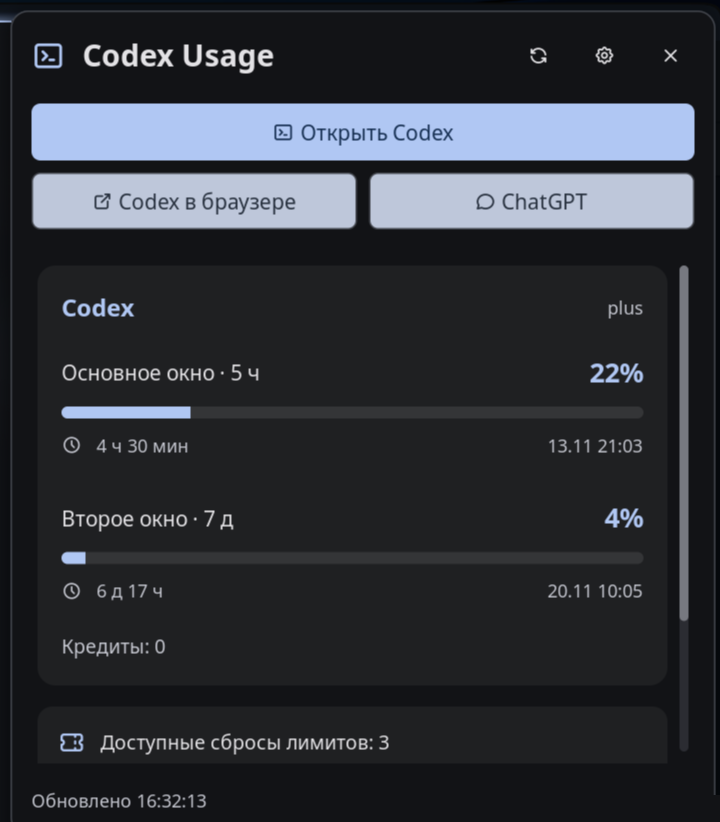
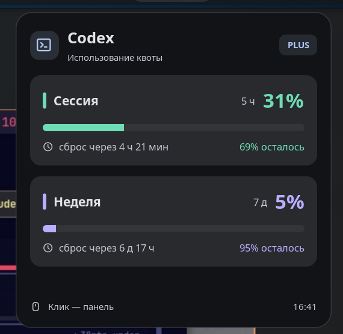

# Codex Usage для Noctalia

Локальный плагин Noctalia 5: использование Codex в баре и во всплывающей панели.

- Основное и второе окно квот с фактической длительностью из Codex (обычно 5 часов и неделя).
- Цветная карточка при наведении: прогрессбары сессии и недели, остаток квоты и время сброса; появляется после короткой задержки и исчезает при уходе мыши.
- Полосы **использованной** квоты; предупреждение от 70%, красный от 90%.
- Обратный отсчёт до сброса и точное местное время сброса.
- План аккаунта, баланс кредитов и число доступных сбросов, когда backend их предоставляет.
- Несколько квот/моделей, если они возвращены Codex.
- Кнопка сброса лимитов с явным подтверждением расхода одного доступного сброса.
- Автообновление раз в 120 секунд, ручное обновление и сохранение последних данных при ошибке.
- Цвета темы Noctalia; горизонтальный и вертикальный бар.
- Кнопки «Codex в браузере» и «ChatGPT» открывают соответствующие сайты в браузере по умолчанию.
- Кнопка «Открыть Codex»: отдельное выпадающее окно Kitty, Esc скрывает его без остановки Codex.



## Управление

| Действие | Результат |
|---|---|
| Левый клик по индикатору | Открыть / закрыть панель |
| Правый клик | Обновить лимиты |
| Средний клик | Стандартные настройки виджета Noctalia |
| Кнопка обновления или Ctrl+R в панели | Обновить лимиты |
| Шестерёнка | Настройки плагина |
| Esc или крестик | Закрыть панель |
| «Codex в браузере» | Открыть https://chatgpt.com/codex |
| «ChatGPT» | Открыть https://chatgpt.com/ |
| «Открыть Codex» | Показать существующее окно Codex или запустить его впервые |
| Esc в окне Codex | Скрыть терминал, сохранив процесс и сессию |
| Ctrl+Shift+Esc в окне Codex | Передать обычный Esc самому Codex |

В баре показаны проценты первого и второго окна; `!` означает ошибку или устаревшие данные. Отсутствующие данные обозначаются тире, а не нулём. Если время сброса прошло, проценты не обнуляются самовольно: ожидается новый ответ Codex.

## Требования

- Noctalia с plugin API 43 или новее; проверено на **5.4.1**.
- Python 3.10+ без сторонних библиотек.
- Для выпадающего терминала: Kitty и Hyprland с Lua-конфигурацией (как в текущей установке).
- Codex CLI с `app-server --stdio` и методом `account/rateLimits/read`; проверено на **0.169.0**.
- Существующий вход через `codex login` в аккаунт ChatGPT. Для API key аккаунтов эти квоты могут быть недоступны; это не монитор стоимости OpenAI API.

## Установка на другой компьютер

Скопируй папку `codex-usage` в `~/.local/share/noctalia/plugins/`, затем выполни:

```sh
noctalia msg plugins enable pvs/codex-usage
```

Добавь имя `codex_usage` в нужную часть `start`, `center` или `end` существующего `[bar.default]` в `~/.config/noctalia/config.toml`, сохранив остальные элементы. Добавь объявление виджета:

```toml
[widget.codex_usage]
type = "pvs/codex-usage:bar"
```

Затем:

```sh
noctalia msg config-reload
```

Панель можно открыть без виджета:

```sh
noctalia msg panel-open pvs/codex-usage:panel
```

На текущем компьютере плагин уже установлен через symlink из этой рабочей папки, включён и добавлен в бар рядом с канбаном. Резервная копия пользовательского конфига: `~/.config/noctalia/config.toml.bak-2026-11-13-codex-usage`.

## Настройки

Шестерёнка в панели открывает стандартные настройки плагина. Либо используй секцию:

```toml
[plugin_settings."pvs/codex-usage"]
refresh_seconds = 120
codex_path = "codex"
show_weekly = true
terminal_directory = "~"
```

`show_weekly` управляет отображением второго окна в баре; в панели оно остаётся видимым. Интервал — от 60 до 1800 секунд. Если Noctalia не находит Codex через PATH, укажи полный путь к исполняемому файлу, например `~/.local/bin/codex`. В поле пути указывается файл, не команда с аргументами.

## Постоянный терминал Codex

Кнопка под шапкой панели закрывает панель лимитов и показывает терминал. Это **отдельный Kitty** с классом `codex-dropterm` на `special:codex`; обычный терминал Win+` на `special:term` остаётся самостоятельным. Размер и положение повторяют его: 70% ширины монитора, 50% высоты, сверху с отступом и затемнением остального экрана.

При первом нажатии запускается `codex` в `terminal_directory` (по умолчанию домашняя папка). При последующих нажатиях показывается уже существующее окно. Изменение папки в настройках применяется к следующему новому процессу; живой процесс не перезапускается.

Esc перехватывается только этим окном Kitty: скрывает special workspace, не отправляя клавишу приложению. Codex сохраняет PTY и продолжает работу в фоне. Ctrl+Shift+Esc передаёт настоящий Esc в Codex. Если явно выйти из Codex или завершить окно/сеанс рабочего стола, процесс завершится; кнопка затем запускает новый. Это сохранение живого процесса при скрытии, а не автоматическое восстановление после перезагрузки.

Для установки на другом Hyprland скопируй `extras/hyprland/codex-terminal.lua` в `~/.config/hypr/` и подключи один раз в Lua-конфигурации:

```lua
require("codex-terminal")
```

Затем `hyprctl reload` и `hyprctl configerrors`. На текущем компьютере правило уже подключено из `rules.lua` через symlink; резервная копия — `rules.lua.bak-2026-11-13-codex-terminal`. Настройки Kitty задаются только аргументами нового окна, общий kitty.conf не меняется. Конкурентные нажатия защищены локальным lock, чтобы не создать две сессии.

## Откуда данные

`service.luau` запускает `tools/usage.py`. Помощник поднимает локальный `codex app-server --stdio`, выполняет initialize, затем `account/rateLimits/read`. Только по явному подтверждению пользователя отдельный вызов использует `account/rateLimitResetCredit/consume`. Codex сам использует свой сохранённый вход. Помощник выводит ограниченный JSON с квотами и завершает дочерний процесс. Один запрос на весь плагин; виджеты и панель читают общее состояние.

Помощник не читает файлы токенов, не отправляет их в собственный HTTP-клиент, не создаёт разговоры и не вызывает модели. Кнопка терминала отдельно запускает интерактивный Codex для работы пользователя. Обращение Codex к серверу лимитов требует сети. Состояние UI хранится в памяти Noctalia; после перезапуска запрашиваются новые данные. Сброс расходуется только после отдельного подтверждения кнопки «Сбросить лимиты…». Автоматическое обновление квот сбросы не выполняет.

При отсутствии сети сохраняется последний успешный снимок с предупреждением. Неизвестные схемы/ошибки не превращаются в «0%». Тексты backend-ошибок, идентификатор аккаунта и авторизационные данные не попадают в вывод помощника.

## Сброс лимитов

При доступных сбросах и актуальном снимке в панели появляется «Сбросить лимиты…». Затем нужно явно нажать «Использовать сброс». Backend выбирает доступный сброс и подходящие окна; наличие кредитов не означает, что текущее окно уже можно сбросить. Если подходящих окон нет, панель покажет ответ Codex. Без доступных сбросов кнопка не предлагается.

Повторное нажатие во время выполнения блокируется. При тайм-ауте или неизвестном результате сохраняется UUID операции в `${XDG_STATE_HOME:-~/.local/state}/noctalia-codex-usage/reset-attempt.json`; повтор использует тот же UUID. Это позволяет backend распознать уже выполненный сброс и не списывать второй. Автоматических повторов расходования нет. Не удаляй файл незавершённой попытки для обхода ошибки: сначала выясни её результат.

Ответы `reset`, `alreadyRedeemed`, `nothingToReset` и `noCredit` отображаются отдельно. После ответа квоты перечитываются с сервера. Реальное расходование сброса при разработке **не выполнялось**: ветки записи и повторов проверены на фальшивом app-server, всего 11 тестов.

## Проверка и разработка

Из корня проекта:

```sh
python3 -m unittest discover -s tests -v
noctalia plugins lint codex-usage
python3 codex-usage/tools/usage.py
```

Последняя команда обращается к реальному аккаунту и выводит только нормализованные данные квот. Unit-тесты используют фальшивый app-server: обычный и multi-bucket ответ, отсутствие полей, handshake, уведомления между ответами, завершение процесса, тайм-аут и скрытие текста ошибки авторизации.

Проверено: цикл show → настоящий Escape через Hyprland → скрытие → повторное show с прежними PID и адресом окна, без дублей; 11 unit-тестов; lint без ошибок и предупреждений; живое чтение квот; загрузка службы, бара и панели в Noctalia; визуальная проверка панели на масштабе 150%.

API app-server развивается, поэтому после крупного обновления Codex может потребоваться адаптация. Пользовательские лимиты могут отличаться от показанных на скриншоте. Длительности не зашиты в код.

## Удаление

Отключи плагин:

```sh
noctalia msg plugins disable pvs/codex-usage
```

Убери `codex_usage` из массива бара и секцию `[widget.codex_usage]`, перечитай конфиг. Если использовалось окно Codex, сначала заверши работу в нём; при удалении полного плагина убери также `require("codex-terminal")` и подключённый Lua-файл Hyprland. Затем можно удалить установленную копию или symlink `~/.local/share/noctalia/plugins/codex-usage`. Вход Codex и другие плагины не затрагиваются.

## Первичные источники

- [Noctalia: разработка плагинов](https://docs.noctalia.dev/noctalia/plugins/development/).
- [Noctalia: runtime API](https://docs.noctalia.dev/noctalia/plugins/development/runtime-api/).
- Протокол проверен по JSON Schema, сгенерированной установленным `codex app-server generate-json-schema`, включая `GetAccountRateLimitsResponse` и `InitializeParams`.
- [Codex app-server](https://learn.chatgpt.com/docs/app-server).

MIT License.

## Карточка при наведении (1.4.0)



Сессия выделена бирюзовым, неделя — лавандовым. От 70% расхода окно становится янтарным, от 90% — красным. Стандартная текстовая подсказка заменена отдельным слоем Noctalia с прогрессбарами: у него нет области ввода и фокуса клавиатуры. Положение определяется по указателю и монитору, карточка ограничена границами экрана. При открытой основной панели она не появляется. Левый и правый клик по виджету сохраняют свои действия.

Проверено живое появление карточки на масштабе 150%; базовый Noctalia менять или пересобирать не требуется.
